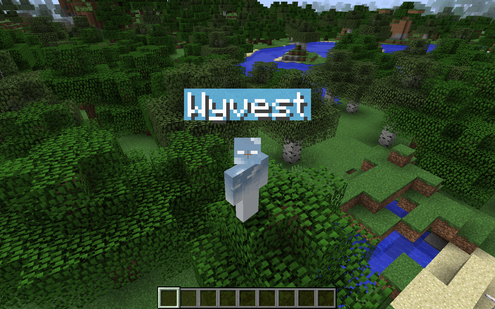

# PolyNametag

PolyNametag restyles the nametags above players and other entities, and shows you your own nametag in third person.

- Move nametags up or down, and scale them down
- Text shadow and custom text color
- Custom background color, rounded corners and padding, or no background at all
- See your own nametag in third person (and in your inventory, if you want)
- Keep nametags visible while the HUD is hidden with F1 (separate toggles for players, armor stands and everything else)
- Hide every nametag with one switch

## Supported versions

- Minecraft 1.8.9 on Ornithe.
- Minecraft 1.21.1-26.3 on Fabric.

PolyNametag needs [OneConfig](https://modrinth.com/mod/oneconfig) and Fabric Language Kotlin.

## Support

- Report bugs and ask questions on the [Polyfrost Discord](https://polyfrost.org/discord).
- Check [Polyfrost Status](https://status.polyfrost.org/) if a Polyfrost service is down.
